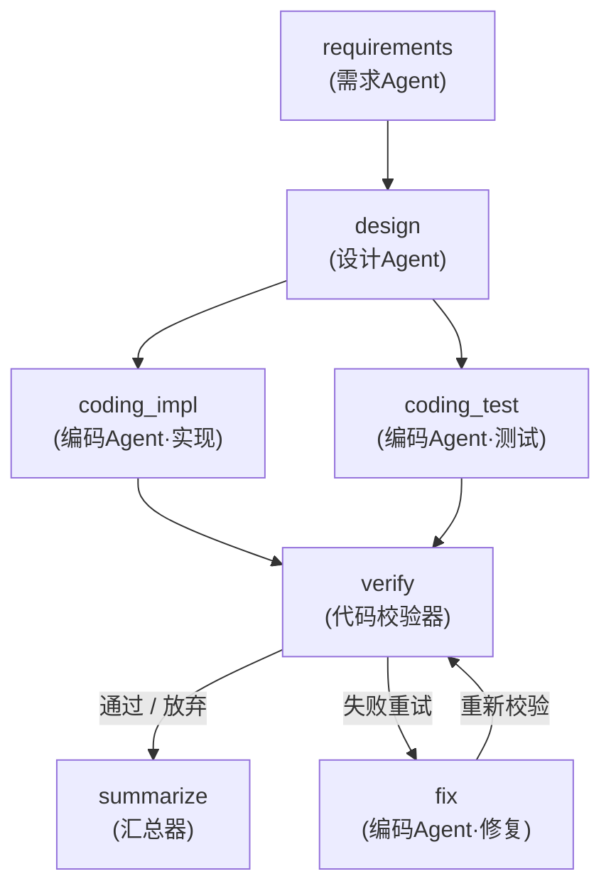

# DESIGN.md — MiniSE-Workflow-MVP 设计文档

> SE2026 · Homework 2 · Simple Workflow MVP
> 选题：**Mini SE 流程**（需求 → 设计 → 代码）

---

## 1. 需求理解与范围

| 作业要求 | 本项目的对应实现 |
|----------|------------------|
| 至少 2 个 Agent 协作 | 3 个 Agent：需求Agent、设计Agent、编码Agent（实现/测试/修复 三模式） |
| Agent 间消息传递或状态共享 | 两者都做了：`MessageBus` 消息总线 + `WorkflowState` 共享黑板 |
| 基本流程控制（顺序执行） | `requirements → design → coding` 顺序链 |
| **推荐**：条件分支 / 循环 / 并行 | 三者全部实现（见 §5） |
| **推荐**：执行日志与状态追踪 | `logs/trace.json` + `outputs/report.html`（流程图 / 甘特图 / 消息流 / 产物） |
| **推荐**：错误处理与恢复 | 节点级重试 + 退避；失败落盘快照；整体优雅降级 |
| 可扩展性 | 引擎与业务完全解耦，新增 Agent 只改装配代码（见 §8） |

---

## 2. 总体架构

```
┌─────────────────────────────────────────────────────────────┐
│  main.py（CLI）                                              │
├─────────────────────────────────────────────────────────────┤
│  src/workflows/   流程装配：唯一的"编排代码"                   │
├──────────────────┬───────────────────┬──────────────────────┤
│  src/agents/     │  src/tools/       │  src/llm/            │
│  需求Agent       │  代码校验器(确定性) │  OpenAI 兼容客户端    │
│  设计Agent       │  汇总器(确定性)    │  离线模拟引擎         │
│  编码Agent       │                   │  LLMBackend 协议     │
├──────────────────┴───────────────────┴──────────────────────┤
│  src/core/   工作流内核（与业务无关）                          │
│    Node / Route / WorkflowGraph / WorkflowState /            │
│    MessageBus / WorkflowEngine / tracing / viz               │
└─────────────────────────────────────────────────────────────┘
```

分层原则：**上层只能依赖下层，且依赖方向单一**。
`src/core` 不知道"需求/设计/代码"这些概念，因此换一个业务流程
（比如作业里的"代码审查流程"）只需要重写 `src/workflows/`，内核零改动。

---

## 3. 核心抽象

### 3.1 Node（节点）

```python
@dataclass
class Node:
    name: str                                   # 唯一标识
    handler: Callable[[WorkflowState], NodeResult]
    deps: list[str]                             # 依赖的节点
    routes: list[Route]                         # 出边（可带条件）
    kind: str                                   # agent | tool（展示用）
    max_retries: int                            # 失败重试次数
```

一个 Node 只声明"我要什么、我产出什么、完成后往哪走"，
**何时被调度由引擎决定** —— 这是把图结构与业务逻辑解耦的关键。

### 3.2 Route（条件边）

```python
@dataclass
class Route:
    target: str
    condition: Callable[[WorkflowState], bool] | None   # None = 无条件
    label: str                                          # 可视化用
```

条件是一个读黑板的纯函数，例如 `_pass_or_give_up`、`_need_fix`。
这样"走哪条边"的判断逻辑就落在数据上，而不是藏在某个 Agent 的代码里。

### 3.3 WorkflowState（共享状态 / 黑板）

```
WorkflowState
 ├── blackboard : dict[key, Artifact]     产物件，写入自增 version
 ├── bus        : MessageBus              全部 Agent 间消息
 ├── runs       : dict[name, NodeRun]     每个节点的执行记录（耗时/状态/轮次）
 ├── meta       : dict                    引擎与路由共享的控制量
 └── snapshot()/restore()                 可整体落盘与恢复
```

`Artifact` 带版本号：修复 Agent 重写 `solution.py` 后版本从 v1 → v2，
报告里能直接看出"谁在什么时候改了什么"。

### 3.4 MessageBus（消息总线）

```python
@dataclass
class AgentMessage:
    sender / receiver / msg_type / payload / refs / seq / ts / attempt
```

`refs` 存黑板键引用，`payload` 只放摘要 —— 避免把几百行代码塞进消息体。
消息带 `seq`，事后可完整重放。

---

## 4. Agent 协作机制

### 4.1 消息流

| # | sender | receiver | type | 内容 |
|---|--------|----------|------|------|
| 1 | 需求Agent | 设计Agent | artifact | "SRS 已完成，共 N 字符；请基于 01_requirements.md 进行设计" |
| 2 | 设计Agent | 编码Agent(实现) | artifact | "设计说明书已完成，请基于 02_design.md 开始工作" |
| 3 | 设计Agent | 编码Agent(测试) | artifact | 同上 |
| 4 | 编码Agent(实现) | 代码校验器 | artifact | "实现代码已就绪（193 行），请等待校验" |
| 5 | 编码Agent(测试) | 代码校验器 | artifact | "单元测试已就绪（122 行），请等待校验" |
| 6 | 代码校验器 | 编排器 | status | "校验未通过，可触发修复" |
| 7 | 编码Agent(修复) | 代码校验器 | feedback | "已修复 solution.py，请重新执行校验" |

一次干净运行产生 **6 条消息**，含修复回边的运行产生 **7 条**。

### 4.2 为什么用黑板而不是"管道"

- 并行分支（`coding_impl` / `coding_test`）要同时读同一份设计文档；
- 循环修复时 `fix` 要同时读历史实现、测试与报错三样东西；
- 管道（A 的输出 = B 的输入）在并行与回环场景下会退化成复杂的连接管理。

黑板 + 消息是 AOP 里经典的 Blackboard 模式，天然支持这两种情况。

### 4.3 编码 Agent 的三模式

三种模式的"读黑板 → 组 Prompt → 调 LLM → 写黑板"骨架完全一致，
差异只在 Prompt，所以用同一个类加 `mode` 参数，而不是写三个类。
新增第四种代码任务只需要加一个 Prompt 常量。

---

## 5. 控制流实现

### 5.1 拓扑



### 5.2 调度算法

```
把无依赖节点标记为已激活
loop:
    ready = [n for n in nodes if 已激活 and 未执行 and 所有依赖已执行]
    if not ready: break
    if len(ready) > 1: 并发执行（线程池）      # ← 并行
    else: 顺序执行
    for 完成的节点:
        for 满足条件的出边 route:
            if 目标已执行过: 重置目标          # ← 形成回边（循环）
            激活目标                           # ← 条件分支由 route.condition 决定
```

| 控制流 | 实现点 |
|--------|--------|
| 顺序 | `deps` 约束：所有依赖 `is_executed()` 才就绪 |
| **并行** | 同一时刻多个节点同时就绪 → `ThreadPoolExecutor` 并发 |
| **条件分支** | `Route.condition` 读黑板上的 `verify_passed` 决定走 `summarize` 还是 `fix` |
| **循环** | 目标已执行过则 `reset_node()` 清除执行标记 → `fix → verify` 回边 |

### 5.3 防死循环

`fix → verify` 这条回边如果不加约束会无限循环，所以：

```python
def _need_fix(s):   # 还有修复额度才走回边
    return not s.meta["verify_passed"] and s.meta["fix_rounds"] < MAX_FIX_ROUNDS

def _pass_or_give_up(s):   # 通过，或额度用尽（记为"放弃"）都进入汇总
    return s.meta["verify_passed"] or s.meta["fix_rounds"] >= MAX_FIX_ROUNDS
```

两条条件互斥且总有一条为真，保证流程一定终止。另设 `max_steps=64`
作为引擎层的兜底熔断。

---

## 6. 状态管理与容错

### 6.1 错误处理分级

| 异常 | 处理 |
|------|------|
| `ConfigError`（缺 Key / 非法 Base URL） | 启动前校验，直接给出可操作提示，不进入流程 |
| `LLMError`（429 / 5xx / 网络超时） | HTTP 层面自动重试 + 指数退避（最多 `LLM_MAX_RETRIES` 次） |
| `NodeExecutionError`（Agent 内部错误） | 节点级重试（`max_retries` 次 + 退避），耗尽后整个流程标记 `failed` |
| 生成的产物不合法（无 `def` / 非unittest） | Agent 主动拒绝写入黑板，视同失败，触发重试 |

### 6.2 追踪与恢复

- 每个节点一次执行都会落一条 `NodeRun`（状态 / 起止时间 / 耗时 / 轮次 / 摘要 / 错误）；
- 全量状态可 `snapshot()` 成 JSON 落盘到 `logs/trace.json`，`restore()` 可恢复，
  这是断点续跑的基础；
- 汇总报告 `outputs/report.html` 离线可看：自绘 SVG 流程图 + 甘特图 + 消息流 + 产物全文。

---

## 7. 关键设计权衡

**① 为什么校验器不是 LLM Agent？**
大模型的输出不能自证正确。流水线里必须有一个**确定性守门员**：
用 `ast.parse` 做语法检查、用 `subprocess` 在临时目录真实执行测试。
它便宜、稳定、可复现，而且它的结论（`verify_passed`）正好是条件路由需要的"事实"。
让 LLM 自己当裁判会让流程结果取决于模型的主观判断，不可复现。

**② 为什么零第三方依赖？**
作业要求"MVP 可运行即可"，最怕的是评审同学 `pip install` 失败跑不起来。
HTTP 用 `urllib`、`.env` 用 20 行解析器、SVG 手绘 —— 全部标准库，
`python main.py run` 开箱即用。

**③ 为什么保留离线模拟引擎（`--sim`）？**
演示、录屏、回归测试都不应该消耗 token，也不应该依赖网络。
模拟引擎只替换"大模型回复"这一段，**引擎的调度、并行、条件分支、回边、
代码落盘与真实执行全部照常发生**，因此可以用来验证内核逻辑（`tests/` 的 11 个用例就用它）。

**④ 为什么自绘 SVG 而不用 Mermaid？**
Mermaid 需要 CDN，断网打开报告就是空白。自绘 SVG（分层布局 + 贝塞尔边）
保证报告在任何环境都能完整显示。

**⑤ 为什么 Agent 之间不直接调用？**
直接调用会把 Agent 焊死在固定的上下游上，无法并行、无法改流程。
消息 + 黑板让 Agent 只依赖"协议"，新增或替换某个 Agent 不影响其他人。

---

## 8. 可扩展性

### 8.1 新增一个 Agent（三步）

1. 在 `src/agents/` 新建类，继承 `BaseAgent`，写 system prompt，实现 `run(state)`；
2. 在 `src/workflows/` 的 `build_workflow()` 里 `graph.add(Node(...))`；
3. 完成。不需要改引擎、不需要改其他 Agent。

### 8.2 换一个流程

作业中的"代码审查流程"只需替换 `src/workflows/` 的装配：

```python
graph.add(Node(name="code",       handler=coder.run,    deps=[],  routes=[Route("review")]))
graph.add(Node(name="review",     handler=reviewer.run, deps=["code"],
      routes=[Route("fix", condition=has_issue, label="有问题"), Route("done")]))
graph.add(Node(name="fix",        handler=fixer.run,    deps=["review"], routes=[Route("review")]))
graph.add(Node(name="done",       handler=summarizer,   deps=["review"]))
```

引擎的调度、并行、重试逻辑完全复用。

### 8.3 换一个大模型

`src/llm/` 面向 `LLMBackend` 协议，任何 OpenAI 兼容服务改 `.env` 即可接入；
非 OpenAI 兼容的厂商实现一个新的 `LLMBackend` 即可，Agent 层零改动。

---

## 9. 运行数据

环境：macOS (arm64) / Python 3.12 / 零第三方依赖。

**运行 A：干净流程**（`python main.py run --sim`）

| 指标 | 值 |
|------|----|
| 节点执行 | 6 次（requirements / design / coding_impl / coding_test / verify / summarize） |
| Agent 消息 | 6 条 |
| 产物 | 6 件，全部 v1 |
| 测试结果 | 20 条用例全部通过（真实 `subprocess` 执行） |
| 总耗时 | 0.13 s（不含网络时延） |

**运行 B：含修复回边**（`python main.py run --sim --simulate-bug`）

首轮实现故意把幂运算写成左结合（`2**3**2` 算成 64），于是：

```
verify 第 1 次 → 校验未通过 → fix 第 1 次 → verify 第 2 次 → 校验通过 → summarize
```

| 指标 | 值 |
|------|----|
| 节点执行 | 7 次（其中 verify 执行 2 次） |
| `solution.py` 版本 | v1 → v2 |
| 修复轮次 | 1 |
| 最终测试 | 20 条用例全部通过 |
| 总耗时 | 0.21 s |

两次运行均以 `status=success` 结束，`report.html` 中的甘特图可以清楚看到
`verify` 的两段执行条。

---

## 10. 已知限制与改进方向

| 限制 | 改进方向 |
|------|----------|
| 并行用线程池而非异步 | 迁移到 `asyncio`，更适合 I/O 密集的 LLM 调用 |
| 状态快照只做了存储，未做自动续跑 | 引擎启动时检测快照并从断点恢复 |
| 校验只覆盖 Python | 抽象 `Verifier` 接口，按语言注册 |
| 无成本/Token 预算控制 | 在 Engine 上加 `budget` 钩子，超限熔断 |
| 上下文截断是简单的前 N 字符 | 改为按节选摘要（抽取关键段落）压缩 |
